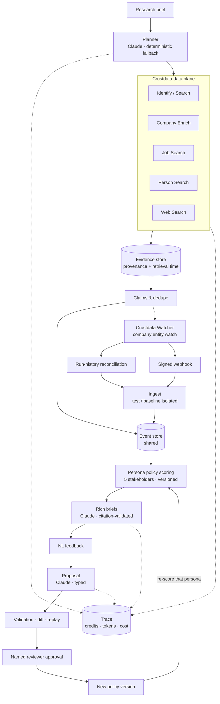

# Architecture diagram

Notes: Watcher create/read-back and run-history reconciliation are live-verified; the signed webhook receiver is unit-tested only (no public HTTPS URL), and no Watcher change event has been received yet. Monitoring is scheduled, not real time.
